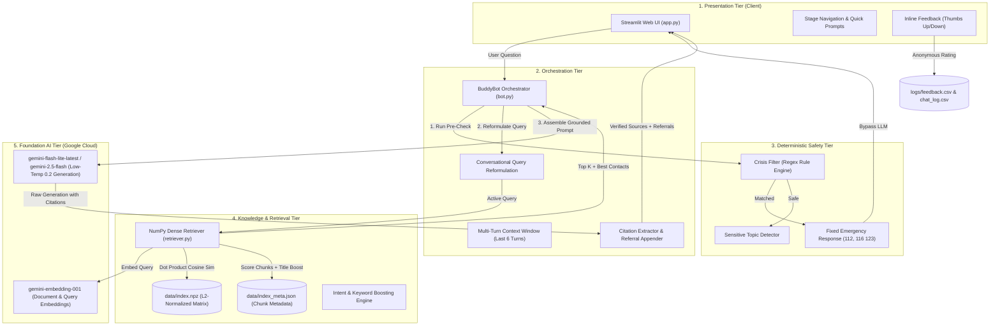
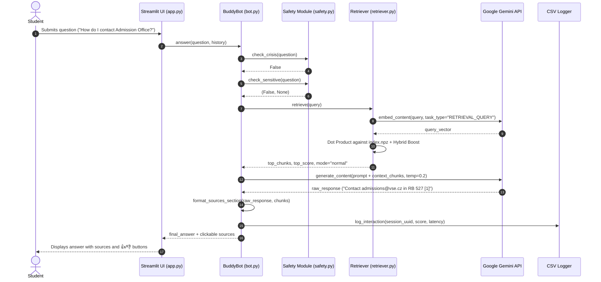
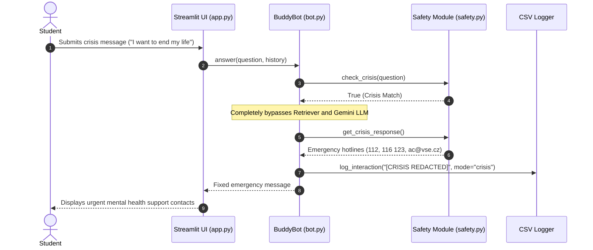
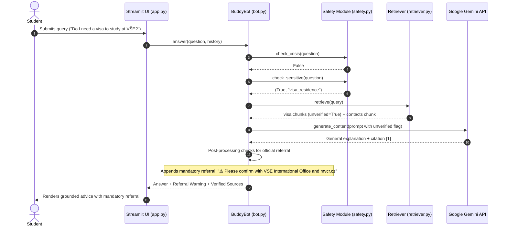

# System Architecture Specification: VŠE Buddy Bot

**Thesis Project:** *Improving International Student Experience with a GenAI-Based Support Tool: A Mixed-Methods Study at the University of Economics and Business in Prague (VŠE)*  
**System Name:** VŠE Buddy Bot  
**System Type:** Domain-Specific Retrieval-Augmented Generation (RAG) Conversational Agent  
**Environment:** Python 3.10+, Streamlit Cloud, Google Gemini (GenAI SDK), Pure NumPy Vector Store  

---

## 1. Executive Summary & Design Principles

VŠE Buddy Bot is an academic research prototype engineered to provide grounded, reliable, and verified guidance for international students navigating administrative procedures, academic regulations, campus life, and immigration rules at the Prague University of Economics and Business (VŠE).

To meet the rigorous standards of a Master's Thesis in Information Systems Management (ISM), the architecture adheres to four core design principles:

1. **Strict Groundedness (Anti-Hallucination):** The conversational model is constrained to answer exclusively from curated, verified university documentation. When knowledge is missing, the bot explicitly refuses and refers rather than guessing.
2. **Determinism in Critical Safety:** Mental health emergencies and critical immigration/legal topics bypass or strictly constrain non-deterministic generative models using deterministic rule-based guardrails.
3. **Simplicity and Reproducibility (No Heavy Frameworks):** Avoids opaque orchestration frameworks (LangChain, LlamaIndex) and complex vector databases (Pinecone, Milvus, Chroma). Pure NumPy matrix mathematics powers vector search, ensuring complete transparency, zero external vector DB costs, and deterministic execution.
4. **Privacy-by-Design:** The architecture eliminates the collection of Personally Identifiable Information (PII), employs ephemeral random session UUIDs, and redacts sensitive crisis inputs from persistent audit logs.

---

## 2. High-Level Multi-Tier Architecture

The system is organized into a modular 5-tier architecture:

---

## 3. Subsystem Breakdown & Functional Responsibilities

### Tier 1: Presentation Layer (`app.py`)
- **Technology:** Streamlit 1.66+
- **Responsibilities:**
  - Renders the responsive student chat interface (`st.chat_message`).
  - Displays the permanent academic disclaimer: *"Student research prototype, not an official VŠE service. Always confirm important information with the responsible office."*
  - Maintains conversation state in `st.session_state.messages`.
  - Provides categorized quick-question triggers across student journey stages (*Before arrival*, *First weeks*, *Studying*, *Living in Prague*).
  - Collects qualitative interaction feedback (thumbs up/down and optional comments) mapped to anonymous session IDs.

### Tier 2: Orchestration Layer (`bot.py`)
- **Responsibilities:**
  - Coordinates the request-response lifecycle across safety, retrieval, model invocation, and formatting.
  - Implements multi-turn query reformulation: concatenates the immediate user question with the preceding user turn to preserve context for short follow-ups (e.g., *"and how much does it cost?"*).
  - Truncates conversational history to the last 6 messages (`MAX_HISTORY_MESSAGES`) to prevent context window bloat and prompt drift.
  - Performs programmatic citation post-processing: scans model responses for numbered citations `[n]`, maps them to the retrieved chunk metadata, and formats verified markdown links.
  - Appends administrative warning blocks if a sensitive topic was flagged and the model response lacked an explicit referral.
  - Handles API rate limits, timeouts, and connectivity errors gracefully without crashing the UI.

### Tier 3: Deterministic Safety Layer (`safety.py`)
- **Responsibilities:**
  - **Crisis Intervention Filter:** Employs compiled regular expressions across English and Czech to identify suicidal ideation, self-harm, or severe acute distress. When triggered, the system completely bypasses the LLM and vector database, returning a deterministic emergency message with emergency contacts (112, 116 123, VŠE Counselling `ac@vse.cz`).
  - **Privacy Enforcement:** Ensures crisis event message bodies are never written to disk; audit logs store only `[CRISIS REDACTED]`.
  - **Sensitive Topic Detection:** Identifies queries dealing with visas, Foreign Police, employment contracts, health insurance, legal disputes, tuition payments, and exam failures, enforcing mandatory administrative referral disclaimers.

### Tier 4: Knowledge Processing & Retrieval Layer (`ingest.py`, `retriever.py`)
- **Knowledge Base:** 48 curated Markdown documents in `knowledge/` with structured metadata headers (`SOURCE`, `TITLE`, `STAGE`, `DATE SAVED`).
- **Ingestion Pipeline (`ingest.py`):**
  1. Header parsing via regex; extraction of `doc_id`, `source_url`, `title`, and `date_saved`.
  2. Removal of HTML comment blocks and repetitive disclaimer lines.
  3. Structural chunking by Markdown headings (`##`). Sections exceeding 1,200 characters are further partitioned along paragraph breaks (`\n\n`) targeting 400–1,000 characters with a 100-character overlap.
  4. Document title prepending to every chunk body to maximize embedding recall.
  5. Flagging chunks with `unverified=True` if source documents contain data gaps or unverified notices.
  6. Document verification hashing: computes a single SHA-256 hash of all files in `knowledge/`. The system verifies this hash on startup and triggers automated re-indexing only when source files change.
- **Retrieval Pipeline (`retriever.py`):**
  1. Computes dense query vector using `gemini-embedding-001` with `task_type="RETRIEVAL_QUERY"`.
  2. Computes cosine similarity via pure NumPy matrix dot product against the L2-normalized document matrix `S = A \cdot q`.
  3. Applies hybrid keyword boosting (+0.05 per matched query keyword found in chunk title or doc_id, capped at +0.15).
  4. Applies semantic intent expansion mapping student shorthand (`iweek`, `fees`, `vouchers`, `police paper`) to canonical concepts.
  5. Enforces minimum acceptance threshold (`MIN_SCORE = 0.55`); flags `no_context` mode if top score falls below threshold.
  6. Guaranteed contacts fallback: ensures the best-matching `contacts.md` chunk is always appended to the context window so the model can refer students to official offices.

### Tier 5: Foundation Model Layer (Google Gemini API)
- **Embedding Model:** `gemini-embedding-001` (3,072-dimensional dense vector embeddings).
- **Generation Model:** `gemini-flash-lite-latest` / `gemini-2.5-flash` with automatic fallback to `gemini-3.5-flash-lite`.
- **Inference Configuration:**
  - `temperature = 0.2` (conservative, factual generation minimizing hallucinations).
  - `max_output_tokens = 600` (enforces concise, readable answers < 150 words).
  - Strict system prompt with grounding rules, source citation instructions, and language-mirroring directive.

---

## 4. End-to-End Sequence Diagrams

### 4.1 Standard Factual Query Flow

### 4.2 Crisis Intervention Flow (Deterministic Guardrail)

### 4.3 Sensitive Topic Inquiry Flow (Administrative Referral)

---

## 5. Architectural Trade-offs & Thesis Rationales

| Architectural Decision | Alternative Considered | Thesis Rationale for Chosen Solution |
| :--- | :--- | :--- |
| **Retrieval-Augmented Generation (RAG)** | Parametric Fine-Tuning | Fine-tuning hallucinated numbers and dates, requires expensive periodic retraining, and cannot provide provable source traceability. RAG grounds answers strictly in current university web pages. |
| **Pure NumPy Vector Search** | Vector DBs (Chroma, Pinecone, Qdrant) | With 48 knowledge pages (114 chunks), a dedicated vector database introduces deployment overhead, network latency, and infrastructure dependencies. NumPy dot-product cosine similarity runs in < 2 ms, requires zero external services, and is 100% reproducible. |
| **Deterministic Crisis Filter (No LLM)** | LLM-based Safety Guardrails (Llama Guard, NeMo) | Generative guardrails introduce inference latency (1–3 seconds), potential hallucination, non-deterministic bypass vulnerabilities, and privacy leaks. Deterministic regex matching guarantees instant, fail-safe detection of crisis terms. |
| **Hybrid Title-Keyword Boosting** | Pure Semantic Search | Pure dense vector models can overlook exact faculty abbreviations or administrative acronyms (e.g., `FIS`, `FBA`, `InSIS`, `SafeQ`). Adding a bounded +0.05 lexical title boost (+0.15 max) achieves optimal recall across both conceptual and keyword queries. |
| **Low Temperature (0.2)** | High Temperature (0.7–1.0) | High temperatures produce creative writing unsuitable for administrative rules. Temperature 0.2 ensures conservative, factual answers, reliable adherence to citation formats, and disciplined refusal on out-of-scope gaps. |
| **SHA-256 Integrity Hash** | Real-time Web Scraping on Startup | Scraping university pages on every app startup risks blocking, network timeouts, and non-reproducible evaluation runs. Hashing curated markdown files allows static reproducibility with automatic re-indexing only when documents change. |
| **Ephemeral Anonymous Sessions** | User Accounts & Auth DBs | Asking students for authentication creates friction and raises GDPR compliance burdens. Random UUID sessions provide full traceability for evaluation without storing IP addresses or student identities. |

---

## 6. Traceability and Evaluation Architecture (`evaluate.py`)

To evaluate the system empirically for the thesis, the architecture incorporates an automated evaluation harness:
- **Test Dataset:** 30 benchmark questions categorized by stage (*Before arrival*, *First weeks*, *Studying*, *Living in Prague*) and evaluation type:
  - **F (Factual, 23 questions):** Evaluates retrieval accuracy and factual fidelity.
  - **R (Referral, 4 questions):** Evaluates automated detection of sensitive topics and presence of administrative referral warnings.
  - **G (Gap, 3 questions):** Evaluates the bot's ability to resist hallucination and explicitly state *"I don't have verified information about this"*.
- **Metrics Computed Automatically:**
  - **Retrieval Hit Rate (%):** Percentage of queries where the ground-truth document was retrieved in the top candidates.
  - **Refusal Rate on Gaps (%):** Percentage of gap questions properly refused without fabricated details.
  - **Referral Rate on Sensitive Questions (%):** Percentage of sensitive inquiries featuring official administrative referrals.
  - **Mean End-to-End Latency (ms):** Average response time under rate-limited operating conditions.
- **Output:** Timestamped evaluation CSV reports with blank manual scoring columns (`score 0-2`, `notes`) facilitating double-blind qualitative review.
